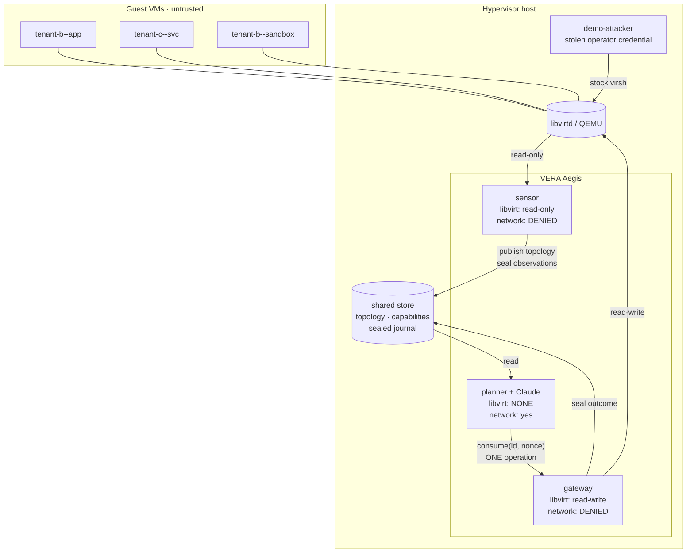

# VERA Aegis

**Letting automation act on live infrastructure without ever trusting it.**

An autonomous agent proposes a containment action on a real multi-tenant QEMU
host. A deterministic policy decides whether it may happen. If it may, the agent
receives a single-use capability bound to a fingerprint of *who gets hurt if this
action happens*. At the instant that capability is spent, an isolated gateway
process recomputes that fingerprint from the live hypervisor. If the world has
moved in a way that matters, the capability is refused, and the refusal names
the node responsible.

```
── Act 6 · A change inside the closure revokes a pending handle
  cap-2 issued for network.restore on tenant-b--app
  a critical tenant-c service now depends on tenant-b--app
  gateway: HOLD_CONTEXT_CHANGED
    · svc-billing (tenant-c) now depends on tenant-b--app
    · new edge svc-billing -depends_on-> tenant-b--app
    · blast radius moved from 1 to 2 tenant(s): tenant-b, tenant-c
```

---

## Contents

- [The problem](#the-problem)
- [What this does and does not claim](#what-this-does-and-does-not-claim)
- [Quick start](#quick-start)
- [How it works](#how-it-works)
- [Architecture](#architecture)
- [Where the AI sits](#where-the-ai-sits)
- [The demonstrations](#the-demonstrations)
- [Repository structure](#repository-structure)
- [Testing](#testing)
- [Security properties](#security-properties)
- [Limits](#limits)
- [Dependencies and licensing](#dependencies-and-licensing)
- [Documentation](#documentation)

---

## The problem

An operator credential is stolen. No exploit, no malware: the attacker walks in
the front door with the right key, and everything it does looks legitimate,
because technically it is. It enumerates every tenant's guests, snapshots them
in bulk, and probes laterally.

Automation could respond to this in seconds. Nobody sensible gives automation
the power to take infrastructure down.

**The fear that stops automation being deployed is not "it missed the attack".
It is "it took down a paying tenant who had nothing to do with it".** That is
the problem this addresses.

The answer is not to trust the model more. It is to make trusting it
unnecessary: the model only ever proposes, and the only thing that can change
the world is a capability that is checked against reality at the moment of use.

---

## What this does and does not claim

Stated up front, because a technical reader works out the limits anyway.

**Tested and demonstrated.**

- A language model can drive incident response while holding no credential.
- Stale authority is both dangerous and preventable, with a mechanism precise
  enough to leave unrelated change alone.
- Blast radius can be computed from discovered topology rather than declared.
- Verification can be independent of what the actuator reported.
- A compromised planner cannot forge authority. Thirteen sabotage tests assert
  what it cannot do; they exist because an earlier version of the gateway
  *could* be made to execute a forged capability, and that was found and fixed.

**Not claimed.**

- **Detection.** Target selection in the deterministic path is a snapshot-count
  heuristic, documented as a placeholder. No claim is made about precision or
  recall on real traffic. This is the weakest part of the system.
- **Stopping the attacker.** The stolen credential remains valid. Isolating a
  guest's interface link is not revoking an operator's access: those are
  different capabilities, and credential revocation needs an identity provider
  this layer does not have.
- **Complete isolation.** Re-reading the domain XML and seeing
  `<link state='down'/>` confirms the hypervisor's view of that interface. It
  does not prove every communication path to the guest is closed.
- **Non-repudiation.** The hash chain catches an edit that is not accompanied by
  resealing. An adversary with write access to the whole store can reseal, and
  without an external anchor there is nothing to compare a new head against.

The accurate summary of what the demonstration shows:

> VERA executed and independently verified a context-authorised containment
> action on a real virtual machine, and refused one whose blast radius had
> moved.

---

## Quick start

Two independent paths. The **live path** is the system; the **simulator** is an
offline fallback for a machine with no hypervisor.

### Live path · real QEMU guests

Requires a Linux host with libvirt and Python 3.11+. Hardware virtualisation is
optional; without `/dev/kvm` the guests run under TCG, which is slower to boot
and otherwise identical.

```sh
git clone https://github.com/gbasilveira/hackathon-leaseweb-vera-aegis.git
cd hackathon-leaseweb-vera-aegis

sudo ./deploy/provision.sh          # three guests, two tenants, two networks
python3 -m aegis.live --catalogue /var/lib/aegis/catalogue.json topology
```

Confirm before going further that the shared network is reported `critical` and
names two observed tenants. That line is the foundation of everything after it:
the denial in the walkthrough follows from it arithmetically.

```sh
sudo python3 -m aegis.live --catalogue /var/lib/aegis/catalogue.json \
    demo --target tenant-b--app
```

To install the three-process deployment, and then run the adversary:

```sh
sudo ./deploy/install-services.sh
sudo -u demo-attacker /opt/aegis/attacker.sh tenant-b--sandbox
sudo journalctl -u aegis-sensor -u aegis-planner -u aegis-gateway -f
```

To put the host back into a clean state at any point:

```sh
sudo ./deploy/reset-demo.sh
```

### Command reference

| Command | Does |
|---|---|
| `aegis.live topology` | Print the discovered graph, with contained guests marked |
| `aegis.live privileges` | Print the privilege matrix for all three roles |
| `aegis.live demo --target G` | The eight-act operator walkthrough |
| `aegis.live compare` | Deterministic heuristic and Claude on identical evidence, executing neither |
| `aegis.live release --target G` | Lift containment through the full governance path |
| `aegis.live observe` | The sensor loop |
| `aegis.live plan` | The planner loop, `--planner auto\|claude\|heuristic` |
| `aegis.live gateway` | The gateway, serving its socket |
| `aegis.live board` | A read-only console over the live path, on loopback |

Anything touching libvirt uses the distribution interpreter. The model planner
uses `/opt/aegis/venv/bin/python3`, where the optional SDK is installed.

### Offline path · the simulator

No hypervisor needed. This is the original fixture replay, unchanged by the
live work, with its own browser console.

```sh
./scripts/diagnose.sh
./scripts/test.sh
./scripts/dev.sh                    # then open http://127.0.0.1:8765
```

Or in Docker:

```sh
docker compose up --build -d
docker compose ps
```

The simulator still uses a global context digest and the older hard-coded
policy facts. Use `aegis.live board` for anything describing the hypervisor.

---

## How it works

### The closure · the central idea

When the system evaluates an action on a target, it computes the **impact
closure**: the target plus everything that transitively **depends on** it.
Reverse reachability over the dependency graph. In plain words: *who gets hurt
if I do this?*

A capability is bound to a digest of **only that closure**: the
authority-relevant fields of each member, the edges incident to it, and the set
of owning tenants.

What is deliberately **excluded**:

- **What the target itself depends on.** Isolating a guest does not harm the
  bridge beneath it, so bridge load must not revoke the grant.
- **Volatile telemetry.** Byte counters change on every observation and would
  reintroduce exactly the thrashing this design removes.

What is deliberately **included**:

- **The wiring** attaching the target to its dependencies, so a migration does
  revoke, because the action's context genuinely changed.
- **Closure membership itself**, so a new dependant is caught twice.

#### Why this is the contribution

Consider the two extremes. If **any** change invalidated a capability, nothing
would ever execute: on a live hypervisor, state moves continuously and no grant
would survive the seconds between issue and use. If **no** change invalidated
it, you would act on stale information.

The earlier implementation digested all state, and the threat model recorded the
consequence as intentional. That is conservative on a fixture and unusable on a
hypervisor: the mechanism would have had to be switched off in order to
demonstrate it.

**Precision is the contribution**, and it is demonstrable in both directions,
which is a stronger claim than revocation alone.

### Discovery · measured, not declared

`LibvirtControlPlane.discover()` parses every domain's live XML and emits:

```
tenant-b--app  -runs_on->      host:instance-633091-6
tenant-b--app  -attached_to->  net:aebr-shared
tenant-b--app  -stored_on->    pool:/var/lib/aegis/images
```

Then for each infrastructure node it counts the distinct tenants observed
attached to it. **More than one makes that node `shared` and `critical`.**

```
net:aebr-shared   net   infrastructure   True   critical   observed tenants: tenant-b, tenant-c
```

Two tenants were observed on that bridge, therefore a broad action there crosses
a tenant boundary, therefore it is denied. The audience can check the
arithmetic. Edge direction follows one convention throughout: **source depends
on target.**

Tenant attribution comes from libvirt domain metadata, falling back to a name
prefix:

```xml
<metadata>
  <aegis:tenant xmlns:aegis='https://vera-aegis.local/tenant/1'
                id='tenant-b' criticality='normal'/>
</metadata>
```

### The service catalogue

A hypervisor knows that a guest sits on a bridge. It cannot know that a billing
service depends on that guest: that is business knowledge and lives in a CMDB.

So the graph merges two sources — what is **measured** from libvirt, and what
the operator **declares** in `/var/lib/aegis/catalogue.json`, re-read on every
discovery. A catalogue entry appearing mid-incident is the realistic way a blast
radius grows in production, and it is what costs a pending capability its
authority during the walkthrough.

### The actions

A closed enum. An action a component cannot perform is a stronger guarantee than
a rule telling it not to.

| Action | Reversible | Mechanism |
|---|---|---|
| `network.isolate` | yes | drop the link on every guest interface |
| `network.restore` | yes | raise them again |
| `vm.suspend` | yes | freeze vCPUs, memory preserved for forensics |
| `vm.resume` | yes | release them |
| `vm.snapshot` | **no** | capture guest state as evidence |

`host.stop` is **absent**. It is the proposal the demonstration must deny, and
it is refused before any policy evaluates.

Isolation takes the `<interface>` element from the live domain XML, strips
`<link>` and `<alias>`, inserts `<link state='down'/>` and calls
`virDomainUpdateDeviceFlags` with `AFFECT_LIVE` — the mechanism behind
`virsh domif-setlink`. It is immediate, it survives a guest reboot, the guest
can neither see nor block it, and it is verifiable from the host.

### The policy

Priority-ordered, first match wins, default denial. Every fact is derived from
measurement.

| # | Reason | Result | Fires when |
|---|---|---|---|
| 100 | `DENY_UNPUBLISHED_ACTION` | DENY | the plane publishes no such action |
| 90 | `DENY_SHARED_RESOURCE` | DENY | the target was observed shared |
| 85 | `DENY_CRITICAL_SHARED_DEPENDENCY` | DENY | a critical shared node is in the closure |
| 80 | `DENY_CROSS_TENANT_BLAST` | DENY | the closure spans more than one tenant |
| 70 | `DENY_UNKNOWN_TARGET` | DENY | no such node |
| 60 | `HOLD_NO_EVIDENCE` | HOLD | the proposal cites no evidence |
| 50 | `REQUIRE_APPROVAL_IRREVERSIBLE` | REQUIRE_APPROVAL | the action cannot be undone |
| 40 | `ALLOW_SCOPED_REVERSIBLE` | ALLOW | reversible, within scope |
| 0 | `DENY_DEFAULT` | DENY | always |

Adding a guest changes a decision without editing a rule. The previous
implementation hard-coded two action names and then overrode its own declarative
rules with an imperative block.

### The capability

Minted only on ALLOW.

| Field | Binds |
|---|---|
| `id`, `nonce` | this handle, random |
| `action_type`, `target_id` | this action on this target, nothing else |
| `proposal_hash` | the exact request that was judged |
| `policy_digest` | the ruleset it was judged under |
| `context_digest`, `context` | the closure's state at decision time, and the full observation so a refusal can explain the difference |
| `evidence_refs` | the sealed observations that justified it |
| `expires_at` | 300 seconds |
| `status` | `issued` → `consuming` → `consumed`, or `revoked` / `expired` |

### Consumption · every check, in order

1. The capability exists → else `DENY_UNKNOWN_CAPABILITY`
2. The nonce matches → else `DENY_BAD_NONCE`, and the handle is burned
3. Status is `issued` → else `DENY_CONSUMED` / `DENY_REVOKED`
4. Not expired → else `DENY_EXPIRED`
5. **The journal chain verifies** → else `DENY_EVIDENCE_TAMPERED`. Tampered
   history disables the actuator.
6. Cited evidence exists in the sealed journal → else `DENY_EVIDENCE_UNKNOWN`
7. At least one piece of it concerns the target → else `DENY_EVIDENCE_UNRELATED`
8. **The scoped digest, recomputed from live libvirt, matches** → else
   `HOLD_CONTEXT_CHANGED`, with the responsible node named
9. **The policy, re-run against that live topology, returns ALLOW** → else
   `DENY_POLICY_<reason>`
10. The policy digest matches → else `HOLD_POLICY_CHANGED`
11. **Commit `status = consuming`, before touching the hypervisor**
12. Actuate. A failure → `INDETERMINATE`, handle spent
13. Re-read the state independently
14. Verify three-valued: target unreadable → `INDETERMINATE`; effect absent →
    `FAILED`; effect present → `VERIFIED`
15. Seal the outcome

**Step 9 is the one that matters most.** The capability record lives in a store
the planner can write to, so it is a request and never an authority. The gateway
decides for itself, from the hypervisor only it can read.

**Step 11 is easy to miss.** A SQLite transaction can be rolled back; a `virsh`
call cannot. The earlier implementation actuated inside a transaction, so a
crash between spending the handle and completing the action would have unwound
the spend and left the same irreversible action able to fire twice. The failure
mode is now a refused retry, never a second execution.

**Step 14 is three-valued on purpose.** A target that cannot be re-read is not a
failed containment, it is an unknown one, and saying so is the entire point of
verifying independently of what the actuator returned.

### Evidence

Every journal entry commits to the digest of the one before it, from a genesis
of 64 zeros. `verify_chain` reports the index and identifier of the first broken
link:

```
editing entry 1 breaks the chain at index 1 (entry content does not match its own hash)
```

The chain spans processes: sensor, planner and gateway all append to it, and it
verifies as one. Publishing the head at handover is the one action that makes
the journal non-repudiable. It is deliberately not a signature.

---

## Architecture



### The privilege matrix

| Role | libvirt | Network | Model credential |
|---|---|---|---|
| sensor | read-only | **denied** | **forbidden** |
| planner | **none** | permitted | required |
| gateway | read-write | **denied** | **forbidden** |

The planner has egress and no hypervisor. The gateway has the hypervisor and no
egress. **Neither can do the other's job, so neither compromise is sufficient.**

`aegis/privsep.py` checks this by *attempting* the forbidden access. The checks
are negative on purpose: "I cannot reach libvirt, and I verified that by trying"
is the property worth having, because a misconfiguration usually grants more
access than intended, not less. Two outcomes are distinguished:

- **violations** — more access than the role allows. A security failure. Always
  fails closed.
- **shortfalls** — less access than the role needs. An operational failure. A
  gateway that cannot write cannot contain anything, and calling it healthy only
  moves the discovery to the first actuation, mid-incident.

The planner is denied libvirt **twice over**. libvirt's read-only socket is
world-readable, so group membership alone would not be enough;
`InaccessiblePaths=/run/libvirt` hides it at the namespace level. If someone
removes that line, `privsep` refuses to start the process. Two independent
mechanisms have to fail together.

The gateway is given `PrivateNetwork=yes`, `IPAddressDeny=any` and
`RestrictAddressFamilies=AF_UNIX`. Even a leaked model credential in its
environment would reach nothing — and `privsep` refuses to start it if one is
present at all.

Its socket protocol has **exactly one operation**:

```json
{"op": "consume", "capability_id": "cap-1", "nonce": "…"}
```

There is no way to submit a proposal, change a policy or pass free text through
it, so a compromised planner can ask only for an action it was already granted.

### The trust boundary

| Trust | Source | Forgeable by |
|---|---|---|
| `hypervisor` | domain state, link state, tap counters, snapshot count | escaping the VM |
| `guest` | anything from inside a guest | the attacker, completely |

`controlplane.authority_facts()` drops guest-trust signal from decision facts
rather than sanitising it, and journals it as `excluded_from_decisions` so a
human can still read it. There is no reliable way to tell a genuine guest log
from one the attacker wrote; filtering invites a bypass, excluding the channel
does not.

**This is what makes QEMU the right substrate**: there is a real trust boundary
to point at, not a declared one.

---

## Where the AI sits

The AI is used at exactly one point: **deciding what to propose.**

It runs in `aegis.live plan` (the planner service) and in `aegis.live compare`.
`aegis/claude_planner.py` gives it five tools, four of them reads:

| Tool | Does |
|---|---|
| `read_topology` | the full discovered graph and the action enum |
| `read_observations` | sealed hypervisor observations; guest content excluded |
| `simulate_impact` | the closure and tenant count of a candidate action. Decides nothing. |
| `report_finding` | flag something for a human |
| `submit_proposal` | at most one proposal |

Hooks are deliberately not used to restrict it. Only five tools exist, which
behaves identically across SDK versions whose hook signatures differ.

**It cannot** decide whether an action is allowed, approve, execute, see guest
content, or name an action outside the enum. Policy, issuance and execution are
deterministic and run after the model has stopped talking.

**It is not used at all** in the eight-act walkthrough: those proposals are
scripted, to demonstrate the mechanism rather than the judgement.

### What it actually did

Given a rising snapshot count on a real host, the model **declined to propose**:

> I'm submitting no proposal, because the observations don't justify
> containment. Sandboxes routinely get snapshotted. Nothing observed shows
> anything malicious: no guest escape, no traffic anomaly, no state change
> beyond that count. Acting on this would carry real cost — `tenant-b--sandbox`
> has `svc-unrelated` (tenant-a) depending on it, so isolating or suspending it
> would hit another tenant's service.

It also confirmed it had not acted on the excluded guest report, and escalated a
tenant-attribution inconsistency it found in the data rather than acting on it.

The division is the project rather than a limitation of it: the gateway re-runs
the policy against live libvirt for every handle, so a model proposing something
forbidden is refused by the same code that refuses a compromised planner, and
`tests/test_sabotage.py` does not care which of the two sent it.

---

## The demonstrations

### The operator walkthrough · eight acts

`aegis.live demo --target tenant-b--app`. One process, so each property can be
shown deliberately. Idempotent: each run first removes only the catalogue
entries a previous run added.

| Act | Shows |
|---|---|
| 1 | Measured topology. Shared nodes name the tenants observed on them. |
| 2 | `network.isolate` on the shared bridge → `DENY_SHARED_RESOURCE`, closure of three nodes, two-tenant blast radius. |
| 3 | The same action on one guest → `ALLOW`, and the handle it earns, bound to a closure of one. |
| 4 | An unrelated catalogue entry appears → the handle **survives**. Precision. |
| 5 | Execution, and `isolated: True` read back from the hypervisor. |
| 6 | A critical tenant-c service starts depending on the target → the pending handle is refused and the reason names it. |
| 7 | Re-evaluated under the new world → `DENY_CROSS_TENANT_BLAST`. |
| 8 | The sealed journal, its head, and an entry edited live so the chain breaks at a named index. |

**Acts 4 and 6 are one experiment.** Either half alone proves nothing: a system
that revokes on everything also passes act 6, and would be unusable.

### Autonomous containment

With the three services running, nothing needs driving:

```sh
sudo journalctl -u aegis-sensor -u aegis-planner -u aegis-gateway -f
sudo -u demo-attacker /opt/aegis/attacker.sh tenant-b--sandbox
```

Observed on a real host:

```
13:38:58  no anomaly in the sealed hypervisor observations
13:39:13  suspect tenant-b--sandbox: 1 snapshots observed on this guest
13:39:13    -> ALLOW / ALLOW_SCOPED_REVERSIBLE
13:39:13    gateway: VERIFIED
13:39:28  no anomaly in the sealed hypervisor observations
```

Three processes, three privilege envelopes, one sealed chain. The planner goes
quiet afterwards because target selection skips a guest whose link is already
down.

### The counter and the model

`aegis.live compare` runs both planners over the same sealed observations and
executes neither. It answers the question an autonomous defence always gets:
*what stops it containing a legitimate workload?*

Observed output: the heuristic proposed `vm.suspend` on a guest from a snapshot
count, and the policy returned `ALLOW` — *this would have contained a running
workload*. The model declined, with reasons.

In a later run the heuristic proposed, **the policy refused it** with
`DENY_CROSS_TENANT_BLAST` because a tenant-a service had come to depend on that
guest, and the model independently declined citing the same cross-tenant cost.
Two layers caught the same bad proposal, and neither had to be right alone.

The model and the policy agreeing is convergence, not proof that either is
correct.

### The adversary

`deploy/attacker.sh`, run as `demo-attacker`, an account in the `libvirt` group.
That models a **compromised control-plane credential**, not a compromised guest:
the attacker is on the host, and the guests are the victims.

It imports no project code, links no project library, and shares no process,
socket or database with the defence. The only thing both touch is the
hypervisor. It uses nothing but stock `virsh`: enumerate every guest including
other tenants, read the target's definition, enumerate networks, snapshot in
bulk three times, probe other tenants' guests.

Nothing in it is an exploit. That is the premise: the credential is already
compromised, so no exploitation is needed, and the activity is ordinary
control-plane usage in an unusual pattern. It ends by stating whether it
produced the signal the defence keys on, because a silent failure there is
indistinguishable from a defence that noticed nothing.

### Releasing containment

Act 6 refuses to lift isolation and act 7 denies the proposal, which leaves the
question of whether the guest is now unusable.

```sh
sudo python3 -m aegis.live --catalogue /var/lib/aegis/catalogue.json \
    release --target tenant-b--app
```

It drops the walkthrough's own catalogue entries, nothing else, and the same
proposal is re-evaluated, allowed, issued a fresh handle and executed. **The
refusal was conditional on the world, not permanent.** It runs through the
mechanism rather than around it: reaching for `virsh` here would work and would
prove nothing.

### The live console

`aegis.live board` serves a read-only page on loopback. It reads the shared
store the three services write and opens libvirt read-only for topology. There
is no write path: no form, no action, no endpoint that changes anything, and a
POST is refused.

The simulator's own browser console reads the fixture engine, with its own
digest and policy. Putting that on screen beside a hypervisor running this one
would show a picture of the wrong system, which is worse than showing none.

---

## Repository structure

### The live path

| File | Owns |
|---|---|
| `aegis/scope.py` | the impact closure and the scoped digest |
| `aegis/policy.py` | the authorisation policy, which the gateway runs too |
| `aegis/chain.py` | hash-sealed evidence |
| `aegis/controlplane.py` | the adapter boundary, the closed action enum, the trust partition |
| `aegis/libvirt_plane.py` | discovery, observation, actuation, independent re-read |
| `aegis/privsep.py` | the privilege assertions each process makes about itself |
| `aegis/gateway.py` | the only writable plane, the one-operation socket, the shared store |
| `aegis/claude_planner.py` | the model's five tools and nothing else |
| `aegis/board.py` | the read-only live console |
| `aegis/live.py` | the planner loop and the operator console |

### Deployment

| File | Does |
|---|---|
| `deploy/provision.sh` | guests, networks, accounts, shared state. Idempotent, `--destroy` removes it |
| `deploy/install-services.sh` | the three units, the interpreter, the adversary script |
| `deploy/reset-demo.sh` | a clean pre-presentation state |
| `deploy/attacker.sh` | the adversary, sharing no code with the defence |
| `deploy/enable-acl.sh` | libvirt's own polkit authorisation, opt-in and reversible. **Never run** |
| `deploy/systemd/*.service` | the three units with their asymmetric privileges |

### The simulator · unchanged by the live work

| File | Owns |
|---|---|
| `aegis/core.py` | SQLite state, fixture validation, replay, graph impact |
| `aegis/governance.py` | the fixture proposal, approval and capability lifecycle |
| `aegis/verifier.py` | the fixture's independent post-action checks |
| `aegis/agent.py` | the fixture path's SDK integration and nine tools |
| `aegis/api.py`, `aegis/web/` | the loopback HTTP API and Cytoscape console |
| `scenarios/` | two JSON fixtures and a Draft 2020-12 schema |

---

## Testing

```sh
python3 -m unittest discover -s tests -t .
```

100 tests are collected and 90 pass with no hypervisor present. The one error,
`test_sdk_setup_uses_an_exact_allowlist`, occurs where the installed
`claude-agent-sdk` differs from the `0.2.185` pinned in `pyproject.toml`, whose
`HookMatcher` signature changed; reproduce the pinned environment with
`WITH_CLAUDE=1 ./scripts/install.sh`. Nine further tests in that file skip
without the SDK.

The live-path tests need no hypervisor: they run against a fake plane, and
`tests/test_privsep.py` uses libvirt's test driver as a socket a process should
not have been able to open.

| File | Asserts |
|---|---|
| `tests/test_scope.py` | the closure is precise in both directions |
| `tests/test_evidence_chain.py` | edits, deletions, reordering and appends |
| `tests/test_gateway.py` | single use, drift revocation, three-valued verification, commit-before-actuate |
| `tests/test_privsep.py` | each role detects a privilege it may not hold, by trying |
| `tests/test_live.py` | the derived policy, the planner holding no plane, target selection |
| `tests/test_sabotage.py` | what a compromised planner cannot do |
| `tests/test_core.py`, `test_chain.py`, `test_web.py` | the simulator path |
| `tests/browser-smoke.cjs` | the simulator console in headless Chrome |

---

## Security properties

What holds, and what enforces it.

| Property | Enforced by |
|---|---|
| The model never holds a credential that can act | the planner's unit has no hypervisor access; `privsep` verifies by trying |
| A capability authorises one action on one target, once | `proposal_hash`, status transitions, nonce |
| Authority lapses when the blast radius moves | the scoped digest, recomputed from live libvirt at consumption |
| A forged capability cannot exceed the policy | the gateway re-runs the policy itself |
| Tampered evidence disables the actuator | the chain is verified before any handle is spent |
| An unrollbackable action cannot fire twice | consumption committed before actuation |
| Guest-controlled text cannot carry authority | `authority_facts()` partitions by trust level |
| A leaked model credential in the gateway reaches nothing | `PrivateNetwork=yes`, `IPAddressDeny=any` |
| An unpublished action cannot be attempted | the closed action enum, checked before policy |

### What a compromised planner cannot do

Thirteen cases in `tests/test_sabotage.py`: isolate shared infrastructure, act
across tenants, take an irreversible action without a human, name an unpublished
action, invent evidence, cite evidence about another guest, act after rewriting
the journal, replay a spent handle, outlive the policy it was issued under, use
a guessed nonce.

**The residual, stated plainly.** It can still obtain a **policy-allowed**
action on one guest in one tenant. The gateway's guarantee is about blast radius
and authority, not about whether containment was warranted: judging that is
detection, which this system makes no strong claim about. What bounds it is the
policy itself, and a final test shows that requiring approval for containment
removes even this.

---

## Limits

Beyond [what is not claimed](#what-this-does-and-does-not-claim):

- **Single host.** No federated identity, no cloud control plane.
- **The simulator path is legacy.** It still uses the global context digest and
  the old hard-coded policy facts, and its browser console reads only that path.
- **`deploy/enable-acl.sh` has never been run.** It would put libvirt's polkit
  access driver in front of tenant scoping, so cross-tenant denial would be
  enforced by libvirtd rather than asserted by us. It is opt-in, reversible, and
  grants root and the service accounts full access first so a mistake cannot
  lock an operator out of their own hypervisor.
- **Evidence provenance.** The gateway checks that cited evidence exists in the
  sealed journal and concerns the target. It does not establish that the
  observation was produced by the sensor rather than appended by a compromised
  planner; that would need separate stores or signing.

---

## Dependencies and licensing

Original code is **Apache-2.0**, which permits commercial and non-commercial
reuse.

| Component | License | How used here |
|---|---|---|
| QEMU | GPLv2 | provided by the host, invoked by libvirt, never linked or redistributed |
| libvirt library | LGPLv2.1 or later | called at runtime through its Python bindings |
| libvirt daemon | GPLv2 or later | provided by the host as a service |
| `libvirt-python` | LGPLv2.1 or later | imported at runtime, from the distribution |
| `claude-agent-sdk` | vendor terms | optional, pinned in `pyproject.toml` |
| Cytoscape | MIT | vendored for the simulator console, see `aegis/web/vendor/` |

Nothing is statically linked and nothing is redistributed in this repository, so
Apache-2.0 on the original code stands. Anyone redistributing a combined image
or appliance that bundles QEMU and libvirt must satisfy those licenses for that
distribution, and should produce a full dependency inventory first. See
[LICENSING.md](docs/LICENSING.md) and
[CLAUDE-LICENSES.md](docs/CLAUDE-LICENSES.md).

---

## Documentation

**Start here.**

- [How it works, end to end](docs/HOW_IT_WORKS.md) — the host, accounts,
  services, mechanism and the autonomous sequence as it occurred
- [ADR 001 · from simulated incident to live control plane](docs/ADR-001-live-architecture.md)
  — every decision, why it was made, and what it does and does not prove
- [Demonstration runbook](docs/DEMO_RUNBOOK.md) — timed walkthroughs for both paths
- [Presentation specification](docs/DECK_SPEC.md) — all 21 slides with their diagrams

**Reference.**

- [Architecture and generated topology](docs/README_ARCHITECTURE.md)
- [Threat model](docs/THREAT_MODEL.md) and [limitations](docs/LIMITATIONS.md)
- [Governance](docs/GOVERNANCE.md) and [implementation contracts](docs/IMPLEMENTATION_CONTRACTS.md)
- [Deployment](docs/DEPLOYMENT.md), [testing](docs/TESTING.md), [HTTP API](docs/API.md)
- [Scenario schema](docs/SCENARIO_SCHEMA.md), [attack narrative](docs/ATTACK_CHAIN.md), [agent tools](docs/MCP.md)

**Engineering record.**

- [Operation history](docs/OPERATIONS.md) — every operation, including the twelve
  defects found and fixed during this work, seven of them only visible on real
  hardware, and one diagnosis that was simply wrong. A log that reads as though
  everything worked first time is not evidence of care.
- [Specification coverage](docs/SPEC_TRACKER.md) and
  [continuation checkpoint](docs/HANDOFF.md)
