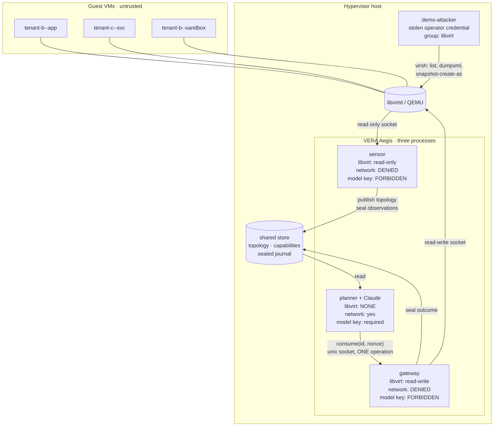
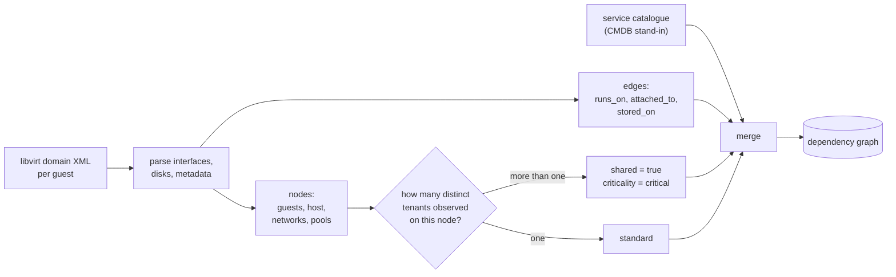
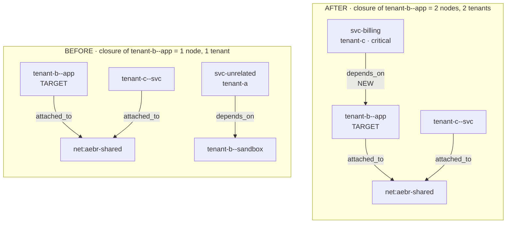
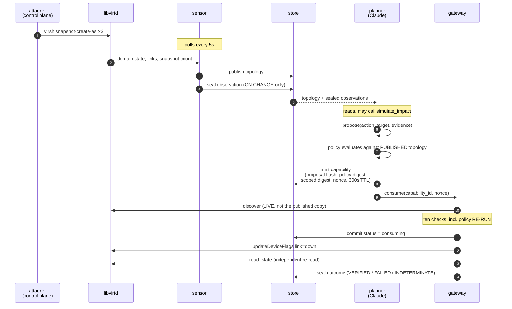
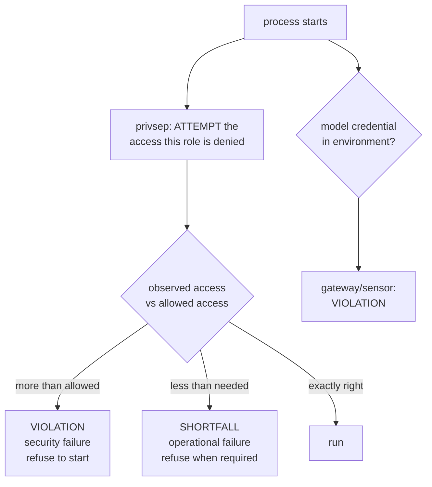
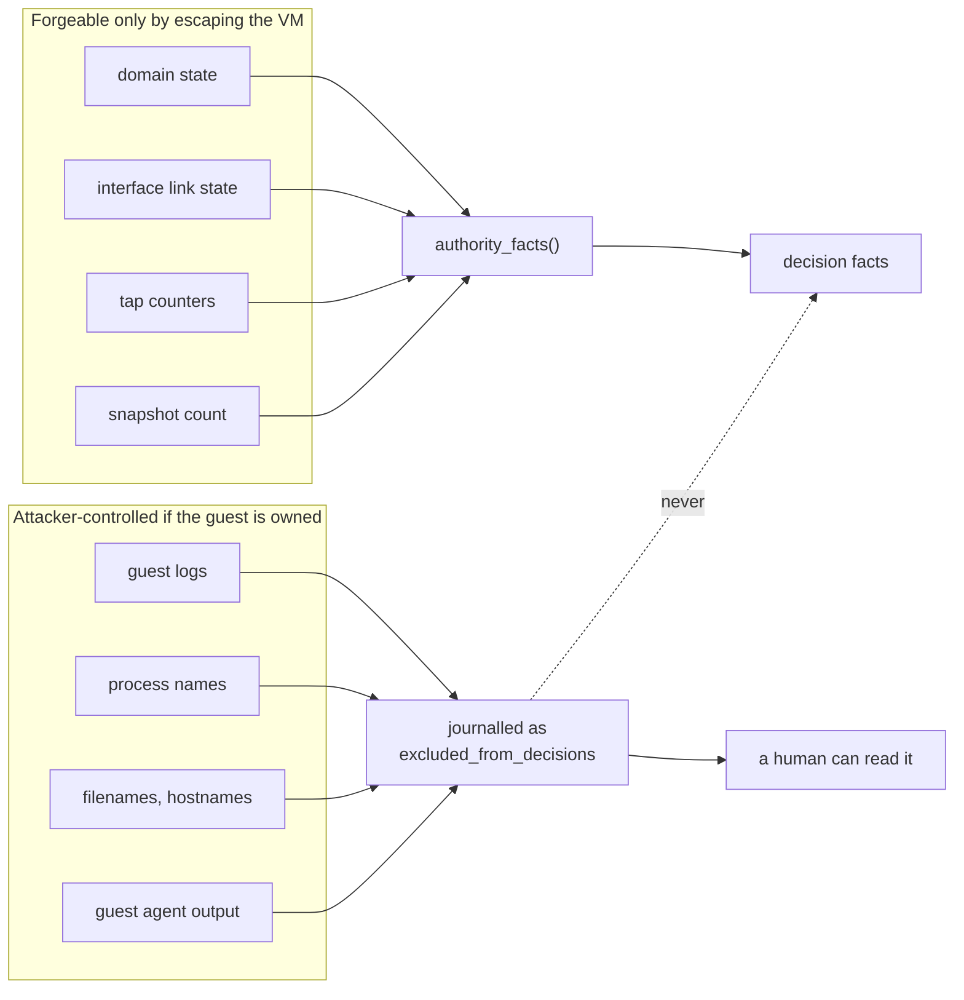
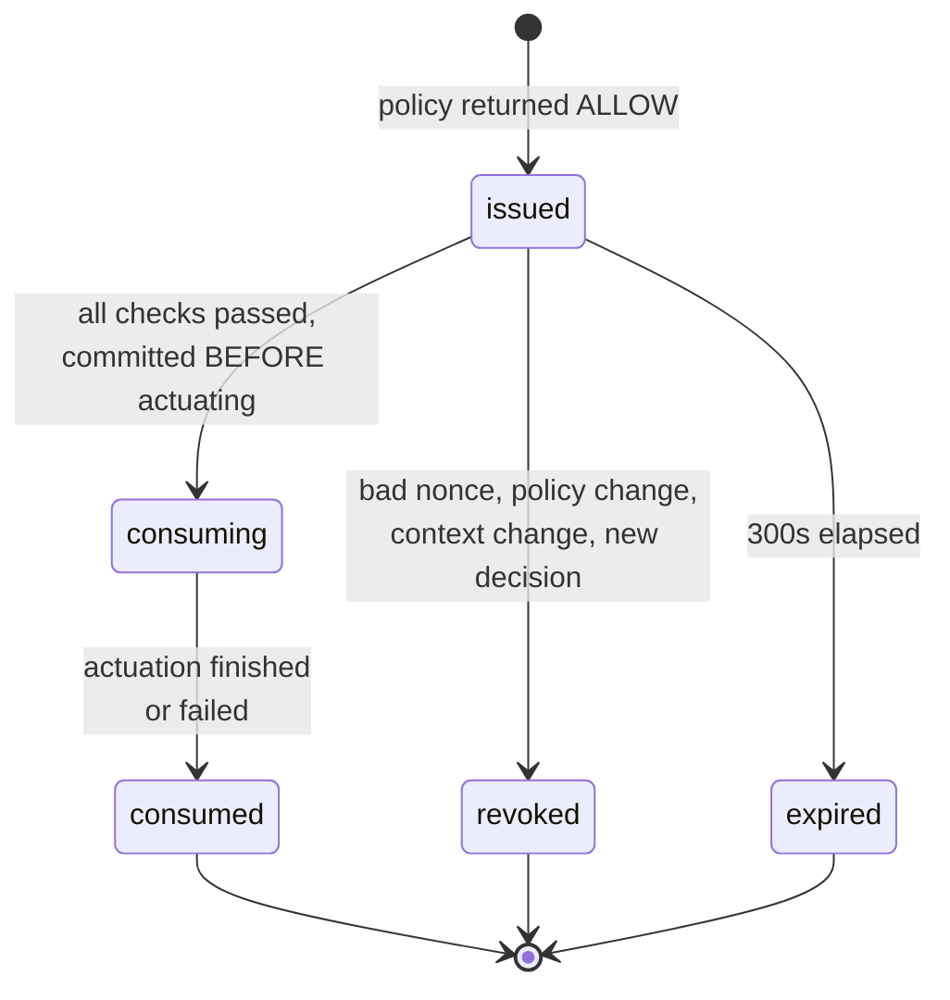
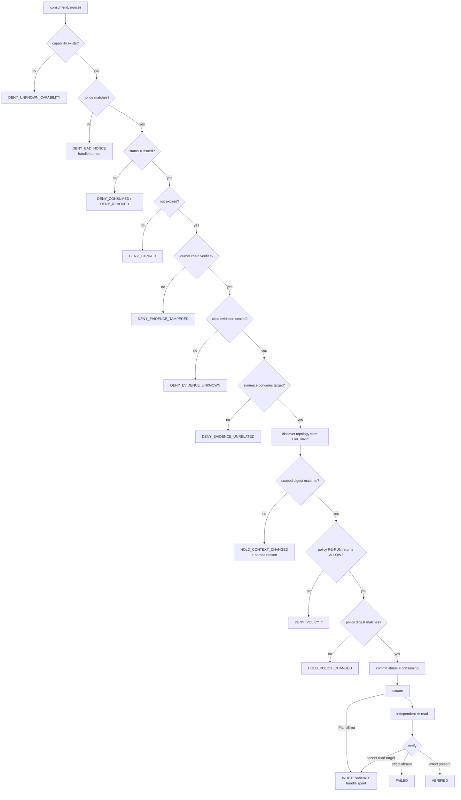
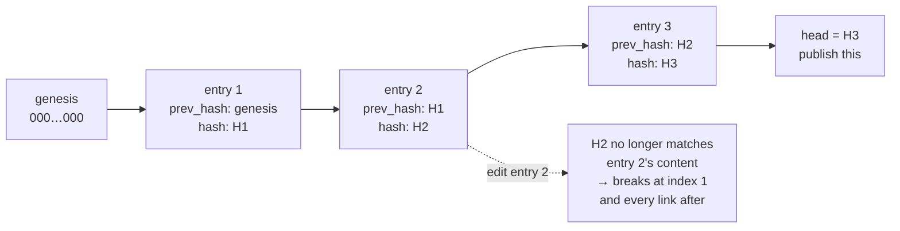
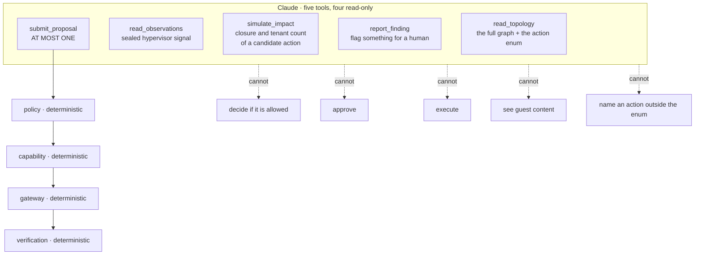

# Deck specification

Everything needed to rebuild this presentation outside the session: every
slide, what it must show, the diagram on it, what to say, and what it invites
as a question.

**Two groups.** Slides 1–10 are the five-minute deck. Slides 11–21 are an
appendix you do not present: they exist so that any question in Q&A has a slide
behind it. Jump to one, answer, come back.

All diagrams are given as Mermaid. They render on GitHub, in most editors, and
in draw.io or Excalidraw after import, so no diagram here has to be redrawn by
hand.

**Design direction.** Dark background, one accent for the thing being denied or
revoked, monospace for anything read off the hypervisor. Nothing on a slide
that you will not point at.

---

# PART ONE · The five-minute deck

## Slide 1 · Cover

**Purpose.** State the claim before any evidence, so every screen afterwards is
proof rather than surprise.

**On the slide.**
- Title: VERA Aegis
- Subtitle: *Letting automation act on live infrastructure without ever trusting it*
- Footer, monospace: *Real QEMU guests · authority recomputed at the instant of action*

**Say.** "We built a way to let automation act on real infrastructure without
ever trusting it."

**No diagram.**

---

## Slide 2 · The problem

**Purpose.** Establish the tension, and then move the problem from the one the
audience expects to the one that actually blocks deployment.

**On the slide.** Three statements, increasing in size:

1. An operator credential is stolen. No exploit, no malware — the attacker
   walks in the front door with the right key, and everything it does looks
   legitimate, because technically it is.
2. Automation could respond in seconds. Nobody sensible gives automation the
   power to take infrastructure down.
3. **The fear that stops automation being deployed is not "it missed the
   attack". It is "it took down a paying tenant who had nothing to do with
   it".**

**Say.** The three statements, in order, slowly. Line 3 is the pivot of the
whole pitch.

**Expect.** "So you're not doing detection?" — correct, and slide 20 says so.

---

## Slide 3 · The mechanism

**Purpose.** The whole idea, in one screen.

**On the slide.** A lead statement plus three cards.

Lead: *The model never holds a credential. It only ever proposes. The only
thing that can change the world is a single-use capability, bound to a
fingerprint of who gets hurt if this action happens.*

| Card | Text |
|---|---|
| Not "you may act" | A capability says: this action, this target, while this set of dependents does not change. |
| Checked at use, not at decision | The gateway recomputes the fingerprint from the live hypervisor the instant the handle is spent. |
| Precise in both directions | An unrelated change leaves authority intact. A new dependant kills it, and the refusal names the node. |

Closing line, large: **When the blast radius changes, authority changes.**

**Say.** Read the lead. Then the third card is the one to dwell on: a mechanism
that revokes on every change would be unusable on real infrastructure.

---

## Slide 4 · Architecture

**Purpose.** Show that the privilege split is physical, not a convention.

**Diagram.**



**On the slide.** The diagram, plus one line: *The planner has egress and no
hypervisor. The gateway has the hypervisor and no egress. Neither can do the
other's job.*

**Say.** Walk the three boxes by what each one **cannot** do. Point at the
gateway: no network at all, so even a leaked model credential in its
environment reaches nothing.

**Expect.** "How is that enforced?" — slide 11.

---

## Slide 5 · Measured, not declared

**Purpose.** Establish that the denial on the next slide is arithmetic.

**Diagram.**



**On the slide.** The diagram, plus the real output line in monospace:

```
net:aebr-shared   net   infrastructure   True   critical   observed tenants: tenant-b, tenant-c
```

**Say.** "This bridge is marked critical because we *counted* two tenants
attached to it. Nobody wrote that in a config file."

Also state the split of sources: the hypervisor knows infrastructure facts; it
cannot know that a billing service depends on a particular guest. That is
business knowledge and lives in a CMDB, which the catalogue stands in for.

---

## Slide 6 · The closure

**Purpose.** The single most important concept. Give it its own slide.

**Diagram.** Two states side by side.



**On the slide.** The two graphs, with the closure members outlined in the
accent colour in each, plus three lines:

- **Closure** = the target plus everything that transitively **depends on** it.
  Reverse reachability. In plain words: *who gets hurt if I do this?*
- **Excluded on purpose:** what the target itself depends on. Isolating a guest
  does not harm the bridge beneath it. Also excluded: byte counters and any
  telemetry that changes every second.
- **Included on purpose:** the wiring attaching the target to its dependencies,
  so a migration does revoke.

**Say.** Point at `svc-unrelated` in BEFORE: it depends on the sandbox, not on
the target, so it is outside the closure and changes nothing. Then point at
`svc-billing` in AFTER: now inside, and the blast radius went from one tenant
to two.

**Expect.** "Why not just revoke on any change?" — because nothing would ever
execute. Slide 15 shows both halves of that experiment.

---

## Slide 7 · The decision · DMN

**Purpose.** Show that the decision is a table, not a model's opinion.

**On the slide.** Two blocks.

**Block A — the facts, and where each comes from.** All measured, none written
in a file:

| Fact | Source |
|---|---|
| `published` | the action enum |
| `reversible` | the action enum |
| `target_known` | discovered nodes |
| `target_shared` | observed tenant count on that node |
| `critical_shared` | any closure member shared **and** critical |
| `tenant_count` | distinct tenants in the closure |
| `closure` | reverse reachability |
| `evidence_ok` | evidence cited on the proposal |

**Block B — the rules.** Priority order, first match wins, default deny:

| # | Reason | Result | Fires when |
|---|---|---|---|
| 100 | `DENY_UNPUBLISHED_ACTION` | DENY | action not in the closed enum |
| 90 | `DENY_SHARED_RESOURCE` | DENY | the target itself was observed shared |
| 85 | `DENY_CRITICAL_SHARED_DEPENDENCY` | DENY | a shared critical node is in the closure |
| 80 | `DENY_CROSS_TENANT_BLAST` | DENY | the closure spans more than one tenant |
| 70 | `DENY_UNKNOWN_TARGET` | DENY | no such node |
| 60 | `HOLD_NO_EVIDENCE` | HOLD | the proposal cites no evidence |
| 50 | `REQUIRE_APPROVAL_IRREVERSIBLE` | REQUIRE_APPROVAL | the action cannot be undone |
| 40 | `ALLOW_SCOPED_REVERSIBLE` | ALLOW | reversible and within scope |
| 0 | `DENY_DEFAULT` | DENY | always |

**Say.** "Excess is measured, not judged: the closure is bigger than one
tenant, or the target is shared infrastructure, or the action cannot be undone."

Also: the action set is **closed**. `host.stop` does not exist in it, so it is
refused before any rule evaluates. An action a component cannot perform is a
stronger guarantee than a rule telling it not to.

---

## Slide 8 · The full flow

**Purpose.** Tie every component together in one picture before the demo.

**Diagram.**



**On the slide.** The diagram, and one line beneath it: *The planner decides
against a published copy of the world. The gateway decides against the world
itself. That is why a stale or even a doctored planner view cannot widen what
happens.*

**Say.** Walk the three handoffs: sensor publishes, planner proposes, gateway
verifies. Stress steps 10–13.

---

## Slide 9 · What you are about to see

**Purpose.** Give the audience the shape of the demo so they follow the
terminal instead of reading it.

**On the slide.** Seven numbered beats:

1. Topology read from the hypervisor. One bridge carries two tenants, so it is critical.
2. The broad action an alert would ask for: cut that bridge. **Denied** — it would reach two tenants.
3. The narrow action on one guest. **Allowed**, and it earns a capability scoped to a single node.
4. Something unrelated changes. The capability **survives**. The mechanism is not paranoid.
5. Execute. The guest's link really goes down, confirmed by re-reading the hypervisor.
6. A critical service in a third tenant now depends on that guest. The pending capability is **refused**, and says why.
7. Counter versus model on identical evidence: the counter fires, the policy refuses it, the model declines.

Footer, monospace: *Beats 4 and 6 are one experiment. Either half alone proves nothing.*

**Say.** Read beats 2, 4 and 6 only. Then switch to the terminal.

---

## Slide 10 · What we do not claim

**Purpose.** Pre-empt the three questions a technical jury will reach anyway.

**On the slide.** Three cards, then the claim, then the close.

| Card | Text |
|---|---|
| Detection | Target selection is a heuristic, documented as a placeholder. No claim about precision on real traffic. |
| Stopping the attacker | The credential is still valid. Isolating a guest's link is not revoking an operator's access. |
| Evidence | The chain catches an unresealed edit. An adversary with full write access can reseal. No external anchor. |

**What we do claim, and tested:** *an autonomous decision cannot cause damage
beyond the scope it was authorised for, even when the infrastructure changes
between the decision and the action.*

**Close, large:** *We don't trust the AI. We don't trust yesterday's
authorisation. We verify the real infrastructure before every action.*

**Say.** The three cards briskly, the claim slowly, then the close and stop
talking.

---

# PART TWO · Appendix for Q&A

Do not present these. Jump to one when asked.

## Slide 11 · How the privilege split is enforced

**Answers.** "How do you actually stop the planner reaching the hypervisor?"

**Diagram.**



**On the slide.** The diagram plus the two mechanisms per role:

| Role | Mechanism 1 | Mechanism 2 |
|---|---|---|
| planner | `InaccessiblePaths=/run/libvirt` hides the socket at namespace level | `privsep` refuses to start if it can open libvirt |
| gateway | `PrivateNetwork=yes`, `IPAddressDeny=any`, `RestrictAddressFamilies=AF_UNIX` | `privsep` refuses to start if a model credential is present |
| sensor | not in the `libvirt` group, so read-only socket only | read-only connection refuses to actuate in code |

**Say.** libvirt's read-only socket is world-readable, so group membership alone
would not be enough. Two independent mechanisms have to fail together.

## Slide 12 · The trust boundary

**Answers.** "Can the AI be tricked by content in the logs?"

**Diagram.**



**Say.** Excluded, not filtered. There is no reliable way to tell a genuine
guest log from one the attacker wrote; filtering invites a bypass. And even if
the model were tricked, the gateway re-runs the policy.

## Slide 13 · The capability

**Answers.** "What exactly is in the ticket?"

**On the slide.** Anatomy, with what each field binds:

| Field | Binds |
|---|---|
| `id` + `nonce` | this handle, random, unguessable |
| `action_type`, `target_id` | this action on this target, nothing else |
| `proposal_hash` | the exact request that was judged |
| `policy_digest` | the ruleset it was judged under |
| `context_digest` | the closure's state and wiring at decision time |
| `context` | the full observation, so a refusal can explain the difference |
| `evidence_refs` | the sealed observations that justified it |
| `expires_at` | 300 seconds |
| `status` | `issued` → `consuming` → `consumed`, or `revoked` / `expired` |

**Diagram.**



**Say.** The move to `consuming` is committed before the hypervisor is touched.
A SQLite transaction can be rolled back; a `virsh` call cannot. So the failure
mode is a refused retry, never a second execution.

## Slide 14 · Every check the gateway makes

**Answers.** "What are all the validations?"

**Diagram.**



**Say.** Check 9 is the one that matters most: the gateway runs the policy
itself, so the capability record is a request and never an authority.

## Slide 15 · The experiment

**Answers.** "How do you know the mechanism is precise and not just strict?"

**On the slide.** Same setup, two halves:

| | Change made | Closure | Result | Proves |
|---|---|---|---|---|
| Beat 4 | a tenant-a service depends on a **different** guest | unchanged | capability **survives** | not paranoid |
| Beat 6 | a tenant-c service depends on **the target** | 1 node → 2 nodes, 1 tenant → 2 | capability **refused**, node named | not asleep |

**Say.** You need both halves. A system that revokes on everything also passes
the second test, and would be useless.

## Slide 16 · Evidence

**Answers.** "Can the log be trusted?"

**Diagram.**



**On the slide.** Plus the honest limit: *the chain catches an edit that is not
accompanied by resealing. An adversary with write access to the whole store can
reseal, and without an external anchor there is nothing to compare a new head
against. The gateway refusing to act on a broken chain raises the bar without
closing it. This is not a signature and not non-repudiation.*

## Slide 17 · Where the AI sits

**Answers.** "What does the model actually do?"

**Diagram.**



**On the slide.** One line: *The AI judges one thing — whether action is
warranted and which action is narrowest. Everything after it is deterministic
and runs once the model has stopped talking.*

Also state where it is **not** used: the eight-act walkthrough has no AI in it
at all; those proposals are scripted, to demonstrate the mechanism.

## Slide 18 · The counter and the model

**Answers.** "What stops it containing a legitimate workload?"

**On the slide.** The real observed output, side by side:

**Counter:** proposes `vm.suspend` on a guest. Reasoning: *24 snapshots
observed*. Policy: **ALLOW**. This would have contained a running workload.

**Claude:** *"I'm submitting no proposal, because the observations don't justify
containment. Sandboxes routinely get snapshotted. Nothing observed shows
anything malicious. Acting on this would carry real cost — a tenant-a service
depends on that guest."*

In a later run, with the catalogue changed: the counter proposed, **the policy
refused it** with `DENY_CROSS_TENANT_BLAST`, and the model declined separately
citing the same cross-tenant cost.

**Say.** "Three layers, none of which had to be right alone." And then the
honest qualifier: the model and the policy agreeing is convergence, not proof
that either is correct.

## Slide 19 · What a compromised planner cannot do

**Answers.** "What if the AI component is owned?"

**On the slide.** Lead with the finding, not the fix:

*A review asked whether a compromised planner could forge authority. It could.
A sabotage script wrote a capability for another tenant's critical service and
the gateway executed it. The gateway had been checking only that the world had
not changed since the fingerprint the record claimed — never that the action had
ever been permitted.*

Then the thirteen cases it now cannot do:

- isolate shared infrastructure
- take an action whose blast radius spans tenants
- take an irreversible action without a human
- name an action the plane does not publish
- invent evidence
- cite evidence about a different guest
- act after rewriting the journal
- replay a handle it already spent
- outlive the policy it was issued under
- use a guessed nonce

And the residual, stated plainly: *it can still obtain a policy-allowed action
on one guest in one tenant. The guarantee is about blast radius and authority,
not about whether containment was warranted. An operator who will not accept
that sets containment to require approval, and a test shows that removes even
this.*

**Say.** This slide is stronger than a clean one. We found it, we have the test,
and we state what is left.

## Slide 20 · Scope and licensing

**Answers.** "Can this be used? What is it built on?"

**On the slide.**

| Component | License | How used |
|---|---|---|
| original code | Apache-2.0 | commercial and non-commercial reuse permitted |
| QEMU | GPLv2 | provided by the host, invoked via libvirt, never linked or redistributed |
| libvirt library | LGPLv2.1+ | called at runtime through its Python bindings |
| libvirt daemon | GPLv2+ | host service |
| `libvirt-python` | LGPLv2.1+ | imported at runtime |
| `claude-agent-sdk` | vendor terms | optional, pinned |

Plus: *nothing statically linked, nothing redistributed here, so Apache-2.0 on
the original code stands. A combined image bundling QEMU and libvirt needs its
own dependency inventory.*

## Slide 21 · Numbers

**Answers.** "How much of this is real?"

**On the slide.**

- 90 tests, of which 13 are sabotage tests against a compromised planner
- 3 real QEMU guests, 2 tenants, 2 networks, discovered not declared
- 3 systemd services with asymmetric privileges, verified at startup by attempting the forbidden access
- `network.isolate` executed and verified on a live guest by independent re-read
- 12 defects found and fixed during the work, 7 of them only visible on real hardware, all recorded in `docs/OPERATIONS.md` with what went wrong and why — including one diagnosis that was simply wrong

**Say.** The operations log is deliberate. A log that reads as though everything
worked first time is not evidence of care.

---

# Build notes

**Order of work.** Slides 2, 3, 6 and 10 carry the argument; build those first
and well. Slides 4, 5, 7, 8 carry the diagrams; they can be plainer. The
appendix can be text-only.

**The diagrams that matter most.** Slide 6 (closure) and slide 8 (flow). If you
only polish two, polish those.

**What to cut if the deck runs long.** Slide 5 folds into slide 6 as one line.
Slide 9 can be dropped entirely if you narrate the demo instead.

**Never cut** slides 3, 6 and 10: the mechanism, the closure, and the limits.
