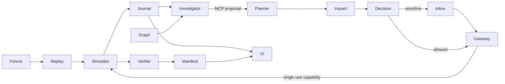

# Architecture

A response playbook can select a remediation in advance. Here the planner can propose several responses, while policy, dependency impact and the current context determine which request the gateway can execute. The deterministic investigator exercises the same governance boundary offline.

Run `python -m aegis graph control-plane-compromise` for the Mermaid graph built from the active fixture definition. The browser graph uses persisted runtime dependencies, including the injected edge.
